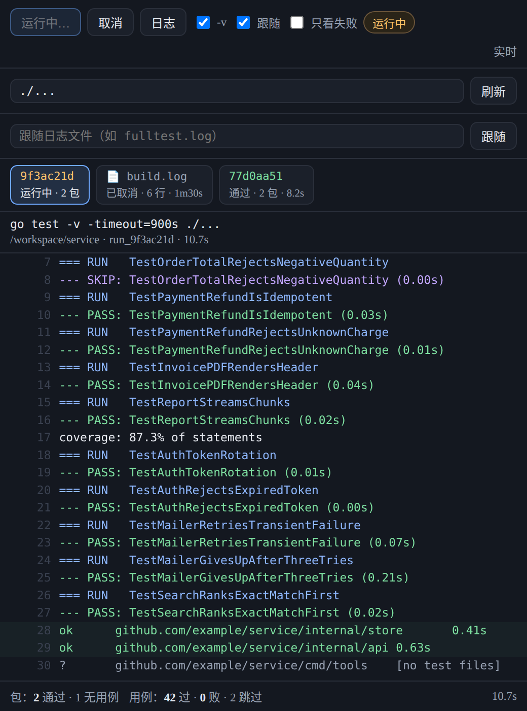

# dsh-test-live

DSH 侧边栏「测试日志」页签：在 GUI 里跑测试，输出**逐行实时**出现，结束后给出失败汇总。
运行记录按**对话归属**而不是按项目绑定——同一个仓库可以从多个对话里跑测试，一个对话也可能在几个目录里工作，
面板汇总的是「这个宿主上所有对话的测试记录」，可以按对话筛。



> 截图用示例数据渲染（`/workspace/service`、`github.com/example/*` 均为占位），配色与布局来自 `src/client/index.js`。
> 截图取自「按项目绑定」的旧版本，**不包含**现在的「全部 / 本对话」筛选栏与对话下拉；以实际界面为准。

## 它解决什么

`go test ./...` 的输出有三个问题：跑得久、被 `| tail` 吞掉、失败信息埋在几百行里。
这个插件把测试进程放进**独立进程组**，通过 SSE 把每一行推给浏览器：

- **不碰宿主**：子进程 `detached` 成自己的进程组，取消/超时对整组发信号；`go test` 派生的测试二进制
  一起死，不会变成孤儿，也不会误伤宿主所在进程组。
- **实时**：进程还在跑就能看到 `=== RUN` / `ok` / `FAIL` 逐行出现，不用等结束。
- **有颜色**：按行分类着色（用例开始/通过/失败/跳过、包结果、构建错误、panic）。
- **有汇总**：包通过/失败/无用例数、用例通过/失败/跳过数、构建错误数、耗时。
- **只看失败**：一键过滤，失败行保留完整上下文。
- **可取消**：面板上的「取消」对进程组发 SIGTERM（3 秒后 SIGKILL）。
- **按对话归属**：一次运行属于「启动它的那个对话」，不属某个项目目录。运行目录取**该对话自己的工作目录**；
  面板显示每条记录属于哪个对话，并可按对话筛选。
- **跨对话汇总**：别的对话里跑完的测试也出现在同一个面板里，跑着的会标「运行中」。
- **历史留档**：结束的运行写进宿主级状态文件，宿主重启后仍在（面板里标「· 历史」）。
- **对话联动**：模型调用 `test_live_run` 启动的运行同样在这个面板里实时显示；工具默认不等待，
  对话不会被一个卡住的测试拖住。
- **跟随文件**：任意来源（终端里 `go test ./... | tee fulltest.log`、bash 调用、CI）只要写进文件，
  面板就能 tail 它——同一条 SSE 通道、同一套着色与汇总，不受「谁启动的」限制。

## 安装

```bash
dsh plugin --profile web add github:stcn52/dsh-test-live
```

包内自带 `cordis.patch.yml`，插件管理器会把它并入 `dsh.profile.bundles`，重启/重载 profile
后侧边栏出现「测试日志」页签。

## 配置

在 profile 的 `cordis.patch.yml` 里按行 id 覆盖：

```yaml
- id: test-live
  name: 'dsh-test-live'
  config:
    cwd: /workspace/service     # 只是兜底：运行目录优先取会话自己的 cwd
    command: go
    baseArgs: [test]
    defaultTimeoutSec: 900
    maxLines: 20000
    maxRuns: 30                 # 内存里条数
    historyRuns: 100            # 落盘条数
    defaultScope: all           # 面板打开时：all = 全部对话，session = 只看本对话
    followRoots: [/workspace]   # 跟随白名单（会话目录会自动加入）
```

| 键 | 默认 | 说明 |
| --- | --- | --- |
| `kind` | `go-test` | `go-test` 追加 `-v/-race/-count/-run/-timeout` 与包模式；`command` 原样执行 `command + baseArgs` |
| `cwd` | `null` | **只是兜底**运行目录：优先取发起运行的对话自己的工作目录，取不到才用这个值，再取不到用宿主进程 cwd |
| `command` | `go` | 可执行文件名（不允许带路径/空格） |
| `baseArgs` | `[test]` | 固定前置参数 |
| `env` | `{}` | 追加环境变量（值会被转成字符串） |
| `maxRuns` | `30` | **内存**里保留多少个已结束运行（1–100），更早的被挤掉 |
| `historyRuns` | `100` | **落盘**保留多少次运行（1–1000），与 `maxRuns` 独立 |
| `historyLines` | `200` | 每条运行落盘保留多少行**尾部**日志（10–2000）；长日志的头部不落盘 |
| `stateFile` | `${DSH_HOME:-~/.dsh}/test-live/runs.json` | 历史状态文件路径；写绝对路径可改位置，写 `''` 保持默认，写 `null`/`false` **关闭持久化**（只在内存里） |
| `defaultScope` | `all` | 面板默认视角：`all` = 全部对话，`session` = 只看本对话（用户仍可在面板里切换） |
| `maxLines` | `20000` | 单次运行的行缓冲上限，超出丢最早的（`seq` 继续增长） |
| `defaultTimeoutSec` | `900` | 默认墙钟上限，可按次覆盖 |
| `followRoot` | `null` | 「跟随文件」的**单个**根目录，是 `followRoots` 的单值别名（排在白名单最前） |
| `followRoots` | `[]` | 「跟随文件」的**白名单**，有序，面板按它出选择器；空数组表示沿用 `followRoot`（再退到 `cwd`） |
| `followIntervalMs` | `300` | 跟随文件的轮询间隔（毫秒，100–5000） |
| `ui.autoScroll` | `true` | 有新行时自动滚到底 |
| `ui.packagesPlaceholder` | `'./...'` | 包输入框的占位提示 |

> `cwd` 与 `stateFile` 的「空值」含义不同，容易踩：`cwd: null` 是「照旧兜底到宿主目录」，
> 而 `stateFile` 要写 `''`（空字符串）才是「用默认路径」，显式写 `stateFile: null`（或 `false`）是**关闭**持久化。
> 包内 `cordis.patch.yml` 因此写的是 `stateFile: ''`。

## 跨对话汇总、历史保留、只看本对话

这三件事是同一个模型的三面：**运行属于对话，面板属于宿主。**

**跨对话汇总。** 所有对话共用一张运行表，面板顶部的 `全部` 视角列出全部记录，每条都带「属于哪个对话 + 该次的目录」。
别的对话正在跑的测试也会实时出现，不需要你切过去。`全部` 视角下还能看到「N 条 · M 个对话」。
HTTP 侧对应 `GET /test-live/runs?scope=all`；模型侧对应 `test_live_runs`（默认就列全部对话）。

**历史保留。** 结束的运行会写进宿主级状态文件，默认 `${DSH_HOME:-~/.dsh}/test-live/runs.json`
（`DSH_HOME` 没设就用 `~/.dsh`）——放在宿主家目录而不是某个项目下，因为这张表是全宿主共享的。
落盘的内容是**元数据 + 每条运行尾部 `historyLines`(200) 行**，条数上限 `historyRuns`(100)；运行结束时写一次、按 100ms 节流合并，
用临时文件 + rename 原子替换，插件卸载时再立即 flush 一次；读不到/写不进/文件损坏都只降级成「没有历史」，绝不会让一次测试失败。
从盘里恢复出来的运行在面板里标「· 历史」；如果宿主是在它运行中挂掉的，恢复后状态是 `canceled` 并附错误
`宿主重启，运行被中断`（子进程已经没了，留个永远转的圈只会误导）。
所以历史是**摘要级**的：想在重启后看完整日志，请自己 `| tee` 一份文件再用「跟随文件」。

**只看本对话。** 面板顶部是 `全部 | 本对话` 分段按钮，选 `本对话` 就只剩当前对话的记录；对话多于一个时，
旁边还有对话下拉，可以跳到任意一个对话的记录（选项来自「拥有运行的对话」，所以已经结束的对话也还在列表里）。
选择记在浏览器偏好里，下次打开沿用。默认视角由 `defaultScope` 决定（默认 `all`）。
HTTP 侧是 `GET /test-live/runs?scope=session&sessionId=…`；模型侧 `test_live_status` / `test_live_cancel` 默认就作用于
**调用它的那个对话**，要看/停别的对话的，显式传 `sessionId`。

## 安全边界

HTTP 面**不接受命令字符串**，只接受：

- `packages`：相对包模式（`./...`、`./database/kdb`），拒绝绝对路径与 `;` 等字符；
- `pattern`：`-run` 的用例名正则，限 `[A-Za-z0-9_./|()\[\]*+?^$-]`；
- `verbose` / `race` / `count` / `timeoutSec` 开关。

也就是说，面板能调的只是「跑哪些包、跑哪些用例、跑多久」，执行的可执行文件永远是配置里的那个。

**跟随范围 = 配置的根 + 当前对话的工作目录。** 允许读的根集合是 `followRoots`（白名单，`followRoot` 是其单值别名，
为空时退到 `cwd`，再退到宿主进程目录），加上**发起调用的那个对话自己的 cwd**——这样一个对话能跟随它正在工作的项目里的日志，
而不必事先写进 profile。边界判定在 `realpath` 之后的真实路径上做前缀比较，根里种一个符号链接也逃不出去；
请求里的 `root` 只能在已允许的根里**收窄**，不能扩宽；不在任何根内的路径一律拒绝（HTTP 400 / 工具报错），
不会被悄悄改写到别的根下。

## HTTP 接口

| 方法 | 路径 | 说明 |
| --- | --- | --- |
| GET | `/test-live/runs?scope=all\|session&sessionId=&limit=` | 运行列表（新的在前）。`scope` 缺省取 `defaultScope`；`scope=session` 但没给 `sessionId` 时退回 `all`；`limit` 上限 500。响应含 `runs` / `sessions` / `scope` / `defaultScope` |
| GET | `/test-live/sessions` | 拥有运行记录的对话列表（含条数、是否有运行中的、最近活动时间）+ `defaultScope`，供面板下拉 |
| GET | `/test-live/status?id=&sessionId=` | 单次运行元信息；缺 `id` 时取最新（给 `sessionId` 则取该对话最新） |
| POST | `/test-live/run` | 启动运行，JSON 选项 + 可选 `sessionId`（决定归属对话与运行目录）→ `202` |
| POST | `/test-live/cancel` | 取消 `{id}`，或 `{sessionId}` 取消该对话最新一次 |
| GET | `/test-live/log?id=&sessionId=` | 纯文本完整日志（`&download=1` 下载） |
| GET | `/test-live/roots` | 配置的跟随根 + 运行目录（只给配置，不做目录列举） |
| POST | `/test-live/follow` | 跟随日志文件 `{path, root?, sessionId?}` |
| GET | `/test-live/stream?id=&since=&sessionId=` | SSE：先补 `since` 之后的历史行，再推新增行；结束时发 `event: status` |

所有 `sessionId` 参数都是可选的：不带它的老客户端看到的仍然是原来的宿主级视图（`scope` 落到 `defaultScope`，
默认 `all`）。未知的 `sessionId`（面板停在一个已结束的会话页上）不会让请求失败，只是退化成「没有对话」的归属。

跟随模式没有退出码可观察：运行会一直是 `running`，直到 `cancel` 停止读取（写入方不受影响）。
文件被截断（再次 `> file`）时从 0 重读，并插一行 `(file truncated, re-reading from the start)`。

SSE 每行是一个 `data: {"seq":N,"text":"...","kind":"...","provisional":false}`；
同一 `seq` 的行会被替换（未换行的半行在补全时原地更新，不重复追加）。

## 工具

| 工具 | 作用 |
| --- | --- |
| `test_live_run` | 启动运行后**立即返回** run id（不占用对话）；运行归属**调用它的对话**、在该对话的 cwd 里执行。`wait:true` 才等结束，等待可被取消打断，上限 300s |
| `test_live_status` | 读某次运行的状态、计数、失败用例与日志尾部。默认读**本对话**最新一次；`sessionId` 读别的对话，`id` 读指定一次 |
| `test_live_runs` | 列出最近的运行（新的在前）：状态、耗时、所属对话、目录、汇总。默认列**全部对话**，`limit` 默认 10、上限 100，`tail` 默认 0（最多回带 200 行） |
| `test_live_follow` | 跟随一个日志文件（外部命令写入），立即返回 run id；路径须在「配置根 + 本对话目录」内 |
| `test_live_cancel` | 停止运行或停止跟随。默认停**本对话**最新那次，不会误停别的对话的运行；对整组发 SIGTERM |

## 已知限制

- **历史是摘要级**：落盘只有元数据 + 每条尾部 `historyLines`(200) 行、条数上限 `historyRuns`(100)。
  重启后面板能续看这 200 行与汇总，更早的行不在盘上；要长期完整日志请自己 `tee` 一个文件再跟随。
- **宿主中途重启的运行会被标成 `canceled`**：子进程随宿主一起没了，恢复时附错误「宿主重启，运行被中断」。
- **跟随范围不是无边界的**：能读的是配置根（`followRoots` / `followRoot` / `cwd` 兜底）加**当前对话自己的工作目录**；
  越界仍拒。旧版本只有一个 `followRoot` 单根，现在多了白名单与「会话目录自动加入」，
  想让某个目录可跟随，要么在 profile 里加进 `followRoots`，要么在需要它的那个对话里发起。
- **顺序是流式的，不是 `-json`**：汇总靠文本标记解析（`go test` 的 `ok`/`FAIL`/`--- FAIL:` 等），
  自定义测试框架的输出仍会原样显示，但不会计入汇总。
- **并发运行不分组**：面板一次只看一次运行；同时启动多次时，仍在运行的那次会被自动选中（列表里能按对话区分）。
- **跟随文件不会自动结束**：没有退出码可观察，只能手动停止；可读范围受「配置根 + 会话目录」限制。
